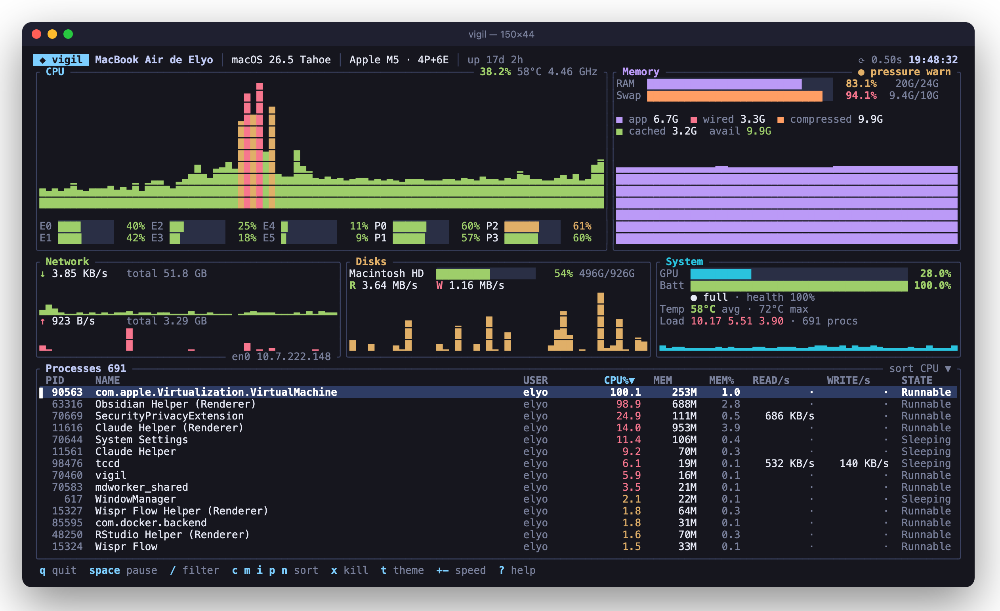
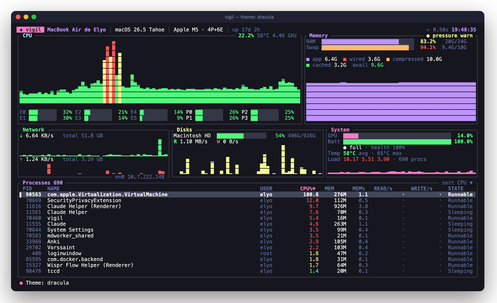

# mulot

> *mulot* (n., French): the wood mouse. Small, quick, and always watching.

**A fast, beautiful terminal system monitor.** One 1.2 MB native binary that shows CPU (with Apple Silicon P/E cores), real memory pressure, GPU, disks, network, temperatures, battery and a sortable, filterable, killable process list. It is tuned for macOS and also runs on Linux and Windows.



```bash
brew install ElyOgl/tap/mulot
mulot
```

## Why

mulot started as a rebuild of [krishnapschauhan/terminal-system-monitor](https://github.com/krishnapschauhan/terminal-system-monitor), a 156-line Node.js + blessed dashboard. Taking it apart (see [docs/UPSTREAM-ANALYSIS.md](docs/UPSTREAM-ANALYSIS.md)) showed that it only really works on Windows. On macOS its memory gauge reports `os.freemem()` and reads **98.6 % used** on a machine with 10 GB available. Its disk panel shells out to `wmic` every second, a command that doesn't exist outside Windows. mulot keeps the idea of a colorful one-screen dashboard and rebuilds the rest from scratch.

| | terminal-system-monitor | **mulot** |
|---|---|---|
| Runtime | Node.js + 60 npm packages | single static binary, no runtime |
| Platforms | Windows (disk panel needs `wmic`) | macOS, Linux, Windows |
| CPU | average graph + per-core table | per-bar colored history, per-core gauges labelled **E0…/P0…** on Apple Silicon, frequency, temperature |
| Memory | `total − freemem` (wrong on macOS) | Activity Monitor's definition (app + wired + compressed), **kernel memory pressure**, swap, breakdown |
| Disks | `wmic` every tick | every real volume (APFS containers de-duplicated), read/write throughput |
| Network | none | ↓/↑ rates with history, totals, active interface + IP |
| GPU / sensors / battery | none | GPU utilisation (no sudo), CPU temperature, charge, state, health, power |
| Processes | none | sortable, filterable table with per-process disk I/O; SIGTERM / SIGKILL with confirmation |
| Controls | quit | pause, refresh speed, sort, filter, kill, 6 themes, help |
| Scripting | none | `mulot --json` snapshot |

## Install

**Homebrew** (macOS Apple Silicon and Intel, Linux x86_64 and arm64):

```bash
brew install ElyOgl/tap/mulot
```

**Prebuilt binaries:** download from [Releases](https://github.com/ElyOgl/mulot/releases), including a Windows `.zip`.

**From source** (Rust 1.88+):

```bash
cargo install --git https://github.com/ElyOgl/mulot
```

## Usage

```
mulot [OPTIONS]

  -i, --interval <MS>   Refresh interval in milliseconds (250–10000) [default: 1000]
  -t, --theme <THEME>   aurora | nord | gruvbox | dracula | ansi | mono  [env: MULOT_THEME]
  -s, --sort <KEY>      Initial process sort: cpu | mem | io | pid | name [default: cpu]
      --json            Print one JSON snapshot of the whole system and exit
      --top <N>         Processes to include in --json output [default: 15]
```

### Keys

| Key | Action |
|---|---|
| `q` / `esc` | quit (`esc` clears an active filter first) |
| `space` | pause / resume |
| `+` / `-` | slower / faster refresh |
| `↑ ↓` `j k` `pgup pgdn` `g G` | move through processes |
| `/` | filter by name, user or PID |
| `c` `m` `i` `p` `n` | sort by CPU, memory, I/O, PID, name (press again to reverse) |
| `s` / `r` | cycle sort column / reverse |
| `x` / `X` | SIGTERM / SIGKILL the selected process (asks first) |
| `t` | cycle theme |
| `?` | help |

### JSON snapshot

```bash
mulot --json --top 5 | jq '{cpu: .cpu.total, pressure: .memory.pressure, gpu: .gpu.usage}'
```

The output contains system info, CPU per core, memory with breakdown and pressure, disks, I/O rates, network interfaces, GPU, sensors, battery and the top processes. It's handy for scripts, status bars and alerts.

## Themes

`aurora` (default on truecolor terminals), `nord`, `gruvbox`, `dracula`, `ansi` (default elsewhere, uses only the 16 standard colors) and `mono`. Cycle live with `t`, or pin one with `MULOT_THEME=nord`.



## How it gets the numbers

Everything is read in-process. mulot never shells out.

- **Memory pressure:** `kern.memorystatus_vm_pressure_level` on macOS, PSI `/proc/pressure/memory` on Linux.
- **Memory breakdown:** `host_statistics64` (app = internal − purgeable, wired, compressed, cached files) on macOS, `/proc/meminfo` on Linux.
- **P/E cores:** `hw.perflevel0/1.logicalcpu`. The efficiency cluster is enumerated first.
- **GPU:** IOAccelerator `PerformanceStatistics` through [sysinfo](https://crates.io/crates/sysinfo). Readable without root.
- **Disk I/O:** volumes that share a physical device report identical counters, so each device is counted once.
- **Computer name:** `SCDynamicStoreCopyComputerName`, so the header doesn't show a DHCP hostname.

## Releasing

Bump `version` in `Cargo.toml`, then push a tag (`git tag v0.3.0 && git push origin main --tags`). GitHub Actions builds macOS (arm64, x86_64), Linux musl (x86_64, arm64) and Windows, attaches the archives and checksums to the release, and then commits the new formula to [ElyOgl/homebrew-tap](https://github.com/ElyOgl/homebrew-tap). The tap push goes through a write deploy key that only works on the tap repo (secret `TAP_DEPLOY_KEY`). No personal token is involved.

> Formerly **vigil** (renamed in 0.2.0). If you installed vigil, switch with `brew uninstall vigil && brew install ElyOgl/tap/mulot`.

## Credits

Inspired by [terminal-system-monitor](https://github.com/krishnapschauhan/terminal-system-monitor) by Krishna Chauhan (MIT). mulot is a from-scratch reimplementation in Rust built on [ratatui](https://ratatui.rs), [sysinfo](https://crates.io/crates/sysinfo) and [starship-battery](https://crates.io/crates/starship-battery).

## License

MIT
